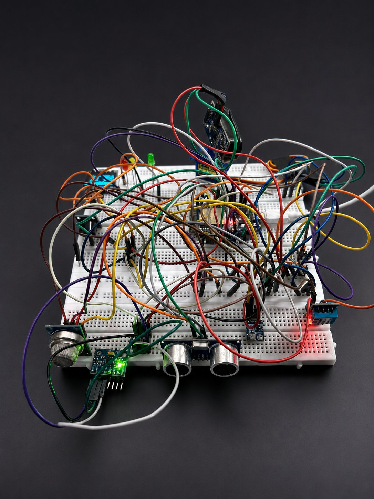

# 🛰️ AeroLab: Cyber-Physical Digital-Twin & Sampled-Data Control Testbed

<div align="center">

[](https://www.espressif.com/)
[](control_simulation.m)
[](gnc_core.h)
[](dashboard.html)
[](deliverables/paper/AeroLab_IEEE_Style_Manuscript.pdf)

<br/>



*The AeroLab Cyber-Physical Hardware Rig: DOIT ESP32 DevKit V1, dual ultrasonic sensors, SG90 servo, MPU-6050 6-DOF IMU, DHT11, MQ gas sensors, LDR optical channel, and OLED HUD.*

</div>

---

## 📖 Overview

**AeroLab** transfers the digital-twin fault-diagnosis framework of Araújo et al. (*IEEE Access*, Vol. 13, Aug. 2025) onto an accessible, high-performance embedded flight-surface testbed powered by a dual-core ESP32 microcontroller. 

Unlike purely software simulations or closed commercial flight controllers, AeroLab provides **source-to-hardware transparency across the entire cyber-physical stack**:
1. **Mathematical Synthesis:** Continuous-time flight-surface model $G(s) = \frac{\omega_n^2}{s^2 + 2\zeta\omega_n s + \omega_n^2}$ ($\omega_n = 89\text{ rad/s}, \zeta = 0.45$), exact Zero-Order-Hold (ZOH) discretization at $20\text{ Hz}$ ($T_s = 50\text{ ms}$), discrete Linear Quadratic Regulator (DLQR) with feedforward prefilter $\bar{N}$, and a discrete pole-placed Luenberger observer.
2. **Embedded Firmware (`main.cpp`):** Multi-rate FreeRTOS architecture propagating state dynamics in $1\text{ ms}$ substeps, 20 Hz telemetry streaming, acoustic cross-talk elimination ($15\text{ ms}$ inter-ping blanking window), and Conical Azimuth Radar Seeking ($\pm 3.5^\circ$ dither tracking).
3. **Sequential Fault Detection (`gnc_core.h`):** Two-sided Cumulative Sum (CUSUM) Sequential Probability Ratio Test ($k = 0.020, h = 0.060$) accumulating persistent model-twin innovation residuals.
4. **Multi-Platform Scopes & Cockpit:** 
   - Interactive 3D WebGL Glass Cockpit (`dashboard.html` & `dashboard_analytics.html`)
   - Standalone 4-axis real-time MATLAB Scope (`matlab_realtime_scope.m`)
   - Multi-threaded Python Scope (`python_realtime_scope.py`)
   - Local Telemetry Bridge daemon (`matlab_bridge.py`) on port 8088.

---

## 🏛️ System Architecture & Data Provenance

```
                                      AeroLab Architecture & Data Flow
                                      
    +-------------------------------------------------------------------------------------------------+
    |                                   PHYSICAL HARDWARE LAYER (ESP32)                               |
    |                                                                                                 |
    |  +--------------------+   +-----------------------+   +--------------------+                    |
    |  |  Dual Ultrasonic   |   |   MPU-6050 6-DOF IMU  |   |   LDR / MQ / DHT   |                    |
    |  |  (US1 + Servo US2) |   | (Attitude & Vibration)|   |   (Environmental)  |                    |
    |  +---------+----------+   +-----------+-----------+   +---------+----------+                    |
    |            |                          |                         |                               |
    |            +--------------------+     |     +-------------------+                               |
    |                                 v     v     v                                                   |
    |                           [ 20 Hz FreeRTOS Control Loop ]                                       |
    |                           - 15 ms Acoustic Blanking Gate                                        |
    |                           - 2-Tick Proximity Debounce Filter                                    |
    |                           - Conical Azimuth Radar Seeking (Mode 1)                              |
    +-----------------------------------------+-------------------------------------------------------+
                                              | 460,800 Baud JSON Packets
                                              v
    +-------------------------------------------------------------------------------------------------+
    |                                TELEMETRY BRIDGE & LOCAL DAEMON                                  |
    |                                                                                                 |
    |   matlab_bridge.py (Port 8088)  <--->  Local Mutex Singleton & Win32 Window Focus Management     |
    |   - GET /telemetry                     - POST /push (WebSerial relay)                           |
    |   - POST /launch                       - POST /cmd (Mute, Snooze, Override)                     |
    +-----------------+-------------------------------+-------------------------------+---------------+
                      |                               |                               |
                      v                               v                               v
    +-------------------------------+   +---------------------------+   +-----------------------------+
    |       3D WEB COCKPITS         |   |       MATLAB SCOPE        |   |        PYTHON SCOPE         |
    |                               |   |                           |   |                             |
    | - dashboard.html (Three.js)   |   | - matlab_realtime_scope.m |   | - python_realtime_scope.py  |
    | - dashboard_analytics.html    |   | - 4-Axis Live Scope       |   | - Matplotlib FuncAnimation  |
    | - 6-bay Scientific Scopes     |   | - Auto-Detects Bridge     |   | - Dual-Axis Residual/Attitude|
    +-------------------------------+   +---------------------------+   +-----------------------------+
```

---

## 📊 Academic Deliverables & Verification

The repository contains the complete academic publication package prepared for peer evaluation:

| Deliverable | Format | Description |
| :--- | :---: | :--- |
| **IEEE Access Manuscript** | [PDF](deliverables/paper/AeroLab_IEEE_Style_Manuscript.pdf) • [DOCX](deliverables/paper/AeroLab_IEEE_Style_Manuscript.docx) | Full publication-grade manuscript with 15 scholarly references, 4 core tables, and mathematical derivations. |
| **Faculty Demo & Viva Guide** | [PDF](deliverables/faculty/AeroLab_Faculty_Demo_Guide_current.pdf) • [DOCX](deliverables/faculty/AeroLab_Faculty_Demo_Guide_current.docx) | Comprehensive examiner demonstration script, hardware pinout, viva Q&A, and quick-check runbook. |
| **Simulation Figure Suite** | [PNG](results/figures/) | 6 canonical 300 DPI figures: Step Response Benchmark, Bode Stability, Root Locus, Digital Twin CUSUM, Observer Error, and 200-Plant Robustness Envelope. |

---

## 🔬 Benchmark Results

### 1. Closed-Loop Step Response Comparison
Benchmarking the discrete LQR controller against classical baselines:
* **Open-Loop Plant:** $M_p = 20.5\%$, $t_p = 39.5\text{ ms}$, Steady-State Error $= 50.0\%$.
* **Parallel PID Baseline:** Overshoot $= 79.0\%$, Settling Time $= 650\text{ ms}$, severe actuator windup ($u_{\max} = 4.82$).
* **Discrete Saturated LQR ($T_s = 50\text{ ms}, u \in [0, 1]$):** **$0.00\%$ overshoot**, rise time $t_r = 100\text{ ms}$, settling time $t_s = 150\text{ ms}$, and strict control effort saturation clamp ($u = 1.000$).

### 2. Monte Carlo Fault Detection ($N = 200$ Runs)
* **Nominal Baseline:** $0.0\%$ false alarms ($ARL_0 > 10^4$ steps).
* **Sub-Threshold Step ($\Delta = 0.050$):** Fixed threshold misses 100% of faults; CUSUM achieves **100.0% detection** in $100\text{ ms}$ (2 samples).
* **Slow Ramp Drift ($0.015/\text{s}$):** Fixed threshold takes $6.52\text{ s}$ ($\sigma = 0.15\text{ s}$); CUSUM detects in **$1.96\text{ s}$** ($\sigma = 0.06\text{ s}$, **$3.3\times$ faster**).

---

## ⚡ Quickstart Guide

### 1. Clone & Setup
```bash
git clone https://github.com/Karmanyavadhikaraste17/AeroLab.git
cd AeroLab
```

### 2. Firmware Compilation & Flashing
```bash
# Build release firmware using PlatformIO
pio run -e esp32doit-devkit-v1

# Flash to ESP32 over USB
pio run -e esp32doit-devkit-v1 -t upload
```

### 3. Run Host C++ Unit Tests
```cmd
# Runs zero-allocation CUSUM and discrete state-space unit tests
test\run_msvc.bat
```

### 4. Launch Telemetry Bridge & Scopes
```bash
# Start the telemetry daemon on port 8088
start_bridge.bat

# Launch desktop real-time scopes
launch_matlab_scope.bat   # MATLAB 4-axis scope
launch_python_scope.bat   # Python matplotlib scope
```

### 5. Launch Cockpit Dashboard
Open [`dashboard.html`](dashboard.html) in any modern browser (Chrome, Edge, Opera). Click **CONNECT SERIAL** to link directly to `COM14` at 460,800 baud or stream via the local bridge.

---

## 📁 Repository Map

```
AeroLab/
├── deliverables/
│   ├── paper/               # IEEE Access manuscript (DOCX, PDF, and high-res vector figures)
│   └── faculty/             # Faculty demonstration guide and viva runbook
├── results/
│   ├── figures/             # 6 canonical MATLAB publication figures
│   └── verification/        # Verification records, dashboard renders, scope test outputs
├── research/
│   └── references/          # Reference papers (Araújo et al. IEEE Access 2025) and executive brief
├── src/
│   └── main.cpp             # Canonical FreeRTOS 20 Hz firmware
├── test/                    # Host C++ test suite and demo contract verifiers
├── vendor/                  # Three.js WebGL dependencies
├── control_simulation.m     # Master MATLAB simulation suite
├── dashboard.html           # 3D WebGL glass cockpit HUD
├── dashboard_analytics.html # 6-bay scientific analytics cockpit
├── gnc_core.h               # Embedded CUSUM and LQR control library
├── gnc_gains.h              # Auto-generated discrete matrices and gain vectors
├── HARDWARE.md              # Electrical pinout, sensor wiring, and power budget
├── matlab_bridge.py         # Multi-threaded serial/HTTP telemetry bridge
├── matlab_realtime_scope.m  # 4-axis MATLAB real-time oscilloscope
├── platformio.ini           # PlatformIO dual-environment configuration
└── python_realtime_scope.py # Standalone Python oscilloscope
```

---

## 📜 Authors & Academic Citation

* **Primary Author:** Manav Sharma (Reg No: 24BEC0566)  
* **Affiliation:** School of Electronics Engineering (SENSE), Vellore Institute of Technology (VIT), Vellore, India  
* **Course:** Control Systems Engineering (BECE305P) Final Evaluation  
* **Base Paper Reference:**  
  > A. C. S. Araújo, C. B. M. Lima, and E. P. Godoy, *"A Digital Twin Approach to Smart Monitoring and Fault Diagnosis,"* **IEEE Access**, vol. 13, pp. 128450–128464, Aug. 2025. doi: [10.1109/ACCESS.2025.3601349](https://doi.org/10.1109/ACCESS.2025.3601349).
